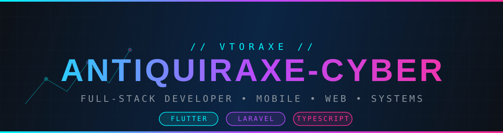

<div align="center">



### Hi, I'm **Sakha Yusuf** — aka **Vtoraxe**


<br/>

[](https://github.com/ryo-ma/github-profile-trophy)

<br/>


</div>

---

## ABOUT_ME

```yaml
name      : Sakha Yusuf
alias     : Vtoraxe
focus     : Mobile Development (Flutter / Dart) + Web (Laravel / TypeScript)
stack     : Dart, TypeScript, JavaScript, PHP, C++, Blade
currently : Final Project — Pemrograman Mobile (Kelompok 2 KH002)
motto     : "Code hard, ship harder."
```

<br/>

<div align="center">

### TECH STACK


</div>

<br/>

<div align="center">
<table>
<tr>
<td>

### WEB DEV


</td>
<td>

### MOBILE DEV


</td>
<td>

### SYSTEMS / TOOLS


</td>
</tr>
</table>
</div>

<br/>

<div align="center">

## HEATMAP

[](https://github.com/ashutosh00710/github-readme-activity-graph)

</div>

---

## FEATURED_PROJECTS

<div align="center">
<table>
<tr>
<td width="50%">

#### Sakha-Yusuf-Kelompok-2-KH002
> **Project Akhir Pemrograman Mobile** — Aplikasi mobile final project kampus.

`Dart` `Flutter`

[](https://github.com/antiquiraxe-cyber/Sakha-Yusuf-Kelompok-2-KH002)

</td>
<td width="50%">

#### WEB-PORTOFOLIO-YUSUF
> **Portofolio Web Personal** — Full TypeScript, modern & responsive.

`TypeScript`

[](https://github.com/antiquiraxe-cyber/WEB-PORTOFOLIO-YUSUF)

</td>
</tr>
<tr>
<td width="50%">

#### mr-whiteweb
> **Web Game Mr. White** — Game deduksi sosial berbasis Laravel.

`Laravel` `Blade`

[](https://github.com/antiquiraxe-cyber/mr-whiteweb)

</td>
<td width="50%">

#### FULL-THROTTLE
> **Full Throttle** — Project web racing/go-kart penuh gas.

`Laravel` `Blade`

[](https://github.com/antiquiraxe-cyber/FULL-THROTTLE)

</td>
</tr>
<tr>
<td width="50%">

#### mount-of-java
> **Mount of Java** — Eksplorasi JavaScript project.

`JavaScript`

[](https://github.com/antiquiraxe-cyber/mount-of-java)

</td>
<td width="50%">

#### HoldMyBear
> **Hold My Bear** — Interactive JavaScript experience.

`JavaScript`

[](https://github.com/antiquiraxe-cyber/HoldMyBear)

</td>
</tr>
<tr>
<td width="50%">

#### Web-Gokart / laravel-gokart / Gokart
> **Go-Kart Series** — Sistem web pemesanan & manajemen go-kart.

`PHP` `Laravel` `Blade`

[](https://github.com/antiquiraxe-cyber/Web-Gokart)

</td>
<td width="50%">

#### Sakha-Yusuf-Kelompok-2-KH002-Praktikum
> **Praktikum C++** — Kumpulan tugas praktikum pemrograman dasar.

`C++`

[](https://github.com/antiquiraxe-cyber/Sakha-Yusuf-Kelompok-2-KH002-Praktikum)

</td>
</tr>
</table>
</div>

---

<div align="center">

## GITHUB_STATS


<br/>


</div>

---

<div align="center">

## SNAKE_EATING_MY_CONTRIBUTIONS

<picture>
  <source media="(prefers-color-scheme: dark)" srcset="https://raw.githubusercontent.com/antiquiraxe-cyber/antiquiraxe-cyber/output/github-snake-dark.svg">
  <source media="(prefers-color-scheme: light)" srcset="https://raw.githubusercontent.com/antiquiraxe-cyber/antiquiraxe-cyber/output/github-snake.svg">
  
</picture>

</div>

---

<div align="center">

## CONNECT_WITH_ME

[](https://github.com/antiquiraxe-cyber)
[](https://instagram.com/)
[](https://linkedin.com/)

<br/><br/>

### *"Code hard, ship harder."*

</div>
